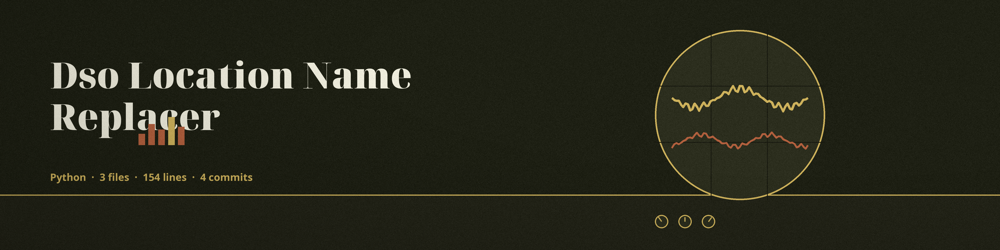

# dso-location-name-replacer
Normalizes generic location type words in a text file. By default the only replacements are generic type words: Street, Ave, Road, Rd, and Blvd become Road, and City and Town become Region. Specific names, such as street names, street numbers, and city names, are not replaced by default. They are replaced only when you supply them in a custom mappings file with `--mappings`. A run that replaces nothing exits non-zero and writes no output, and the output file must differ from the input file.

## Install
`git clone https://github.com/ShadowGuardAI/dso-location-name-replacer`

## Usage
`python main.py input.txt output.txt [--mappings custom_mappings.json]`

The custom mappings file is a JSON object that maps a regular expression pattern to its replacement text. When a mappings file is named but is missing or is not valid JSON, the run exits with an error instead of falling back to the default table.

## Parameters
- `-h`: Show help message and exit
- `--mappings`: Path to a custom location mappings file (JSON format)
- `--log_level`: Set the logging level (default: INFO)

## License
Copyright (c) ShadowGuardAI
